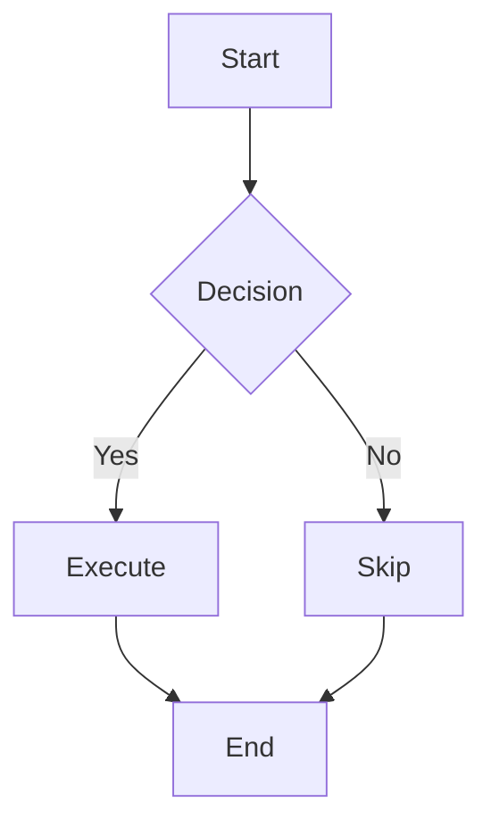

# Markdown Syntax Guide

> A reference to commonly used Markdown syntax in QuickMD. Open Split view (Edit | Preview) to learn the syntax on the left and see the result on the right.

---

## 1. Headings

```md
# Level 1 heading
## Level 2 heading
### Level 3 heading
#### Level 4 heading
##### Level 5 heading
###### Level 6 heading
```

# Level 1 heading
## Level 2 heading
### Level 3 heading
#### Level 4 heading
##### Level 5 heading
###### Level 6 heading

---

## 2. Inline formatting

```md
**Bold**  *Italic*  ~~Strikethrough~~  `Inline code`
```

**Bold**  *Italic*  ~~Strikethrough~~  `Inline code`

---

## 3. Lists

### Bulleted lists

```md
- Item one
- Item two
  - Nested item (indented with two spaces)
```

- Item one
- Item two
  - Nested item (indented with two spaces)

### Numbered lists

```md
1. First step
1. Second step
1. Third step
```

1. First step
1. Second step
1. Third step

> Preview numbers the items 1, 2, 3 automatically. That is how Markdown works: writing `1.` for every item in the source lets you insert a new item without renumbering the rest yourself.

### Task lists

```md
- [ ] Task to do
- [x] Completed task
```

- [ ] Task to do
- [x] Completed task

> `[ ]` means pending; `[x]` means completed (x = checked ☑). Remember to put a space after `]`.

---

## 4. Blockquotes

```md
> This is a blockquote.
>
> A blockquote can contain several paragraphs.

> Blockquotes can also be nested.
>> A second-level blockquote.
```

> This is a blockquote.
>
> A blockquote can contain several paragraphs.

> Blockquotes can also be nested.
>> A second-level blockquote.

---

## 5. Code blocks

Wrap code in three backticks and specify a language for syntax highlighting:

`````md
```python
def hello():
    print("Hello, QuickMD!")
```

```rust
fn main() {
    println!("Hello, Rust!");
}
```
`````

```python
def hello():
    print("Hello, QuickMD!")
```

```rust
fn main() {
    println!("Hello, Rust!");
}
```

In Preview, a language label appears at the top right of the code block. Supported languages include `js`, `ts`, `py`, `rs`, `json`, `bash`, and `md`.

---

## 6. Links

```md
[QuickMD project](https://github.com/druidjay325-tech/QuickMD)
<https://example.com>  A plain URL works too.
```

[QuickMD project](https://github.com/druidjay325-tech/QuickMD)
<https://example.com>

> Before opening an external link, QuickMD asks for confirmation, then hands it to your default browser.

---

## 7. Images

```md

```

Local relative and absolute paths are supported. When you insert an image from the main window toolbar, QuickMD copies it to `.assets` inside the notes folder and generates a relative path:

```md


```

> PNG, JPEG, GIF, and WebP are supported, up to 16 MB per image. The paths above are examples; replace them with paths to your own images to preview them. QuickMD does not automatically load remote images or images on network shares. You can also drop one or more images into the main window or scratchpad to insert them at the current cursor or selection. Switch from Preview to Edit first. Drop text files and images separately; images are copied to `.assets`, and originals are kept.

---

## 8. Tables

Separate columns with `|`, and separate the header from the data with `|---|` (at least three hyphens are recommended for readability):

```md
| Name | Age | City |
| ---- | ---- | ---- |
| Zhang San | 28 | Beijing |
| Li Si | 32 | Shanghai |
```

| Name | Age | City |
| ---- | ---- | ---- |
| Zhang San | 28 | Beijing |
| Li Si | 32 | Shanghai |

> At least three `-` characters are recommended in each cell of the separator row; more are fine too. In Preview, they form a continuous line—the table border, not a horizontal rule.

Alignment: add colons on either side of the hyphens in the separator row.

```md
| Left-aligned | Centered | Right-aligned |
| :----- | :--: | -----: |
| Content | Content | Content |
```

| Left-aligned | Centered | Right-aligned |
| :----- | :--: | -----: |
| Content | Content | Content |

---

## 9. Horizontal rules

Put three or more hyphens on a line of their own. **Leaving a blank line before them is safer**; if they immediately follow a paragraph, that paragraph becomes a level 2 heading:

```md
The previous paragraph.

---

The next paragraph.
```

The previous paragraph.

---

The next paragraph.

---

## 10. Mermaid diagrams

Use `mermaid` as the language label for flowcharts, sequence diagrams, class diagrams, and more:

`````md

`````


> Mermaid offers a wide range of syntax, and QuickMD can preview several diagram types. Preview uses strict security settings, so some HTML labels, images, and interactions are restricted. For complex diagrams, check the actual preview result. Here is a flowchart syntax reference:
> https://www.processon.com/mermaid/flowchart

---

## 11. Footnotes

Mark a footnote with `[^label]` in the text, and define it with `[^label]: Content` at the end:

```md
QuickMD is a lightweight desktop app[^1], designed for capturing fleeting thoughts[^2].

[^1]: Built with Tauri 2.x + React.
[^2]: Also often called “sticky notes.”
```

QuickMD is a lightweight desktop app[^1], designed for capturing fleeting thoughts[^2].

[^1]: Built with Tauri 2.x + React.
[^2]: Also often called “sticky notes.”

Click a footnote number to jump to its definition. Click ↩ at the end of the definition to jump back.

---

## 12. Limits on embedded HTML

Some Markdown tools allow raw HTML, but QuickMD does not execute it. For example, this common collapsible-section markup is shown as text here, rather than becoming a collapsible component:

```md
<details>
<summary>Click to show more content</summary>

This content will not be collapsed in QuickMD. You can use headings or blockquotes to organize your notes instead.

</details>
```

<details>
<summary>Click to show more content</summary>

This content will not be collapsed in QuickMD. You can use headings or blockquotes to organize your notes instead.

</details>

---

## 13. Escaping characters

To display a Markdown syntax character literally, put a backslash `\` before it:

```md
\*These asterisks will not turn the text italic\*
\# This hash will not turn the line into a heading
\\ Display a backslash itself
```

\*These asterisks will not turn the text italic\*
\# This hash will not turn the line into a heading
\\ Display a backslash itself

> These characters can be escaped with `\`:
> `\` `*` `_` `#` `` ` `` `~` `[` `]` `(` `)` `{` `}` `.` `!` `|` `>` `<`
>
> Note: you can usually write `$` and `%` directly here. Writing `\$` or `\%` also displays `$` or `%`, without the preceding backslash.


---

## Shortcut quick reference

| Shortcut | Action |
| ------ | ---- |
| `Alt+Q` | Show/hide the scratchpad. |
