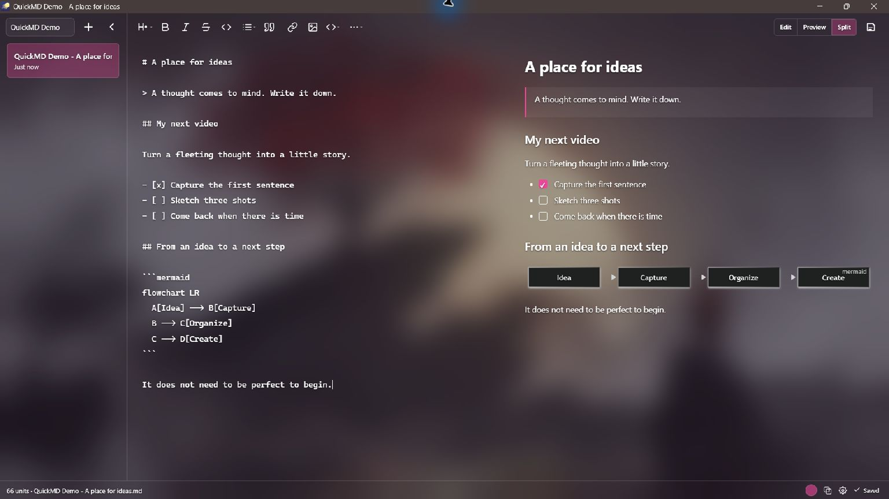
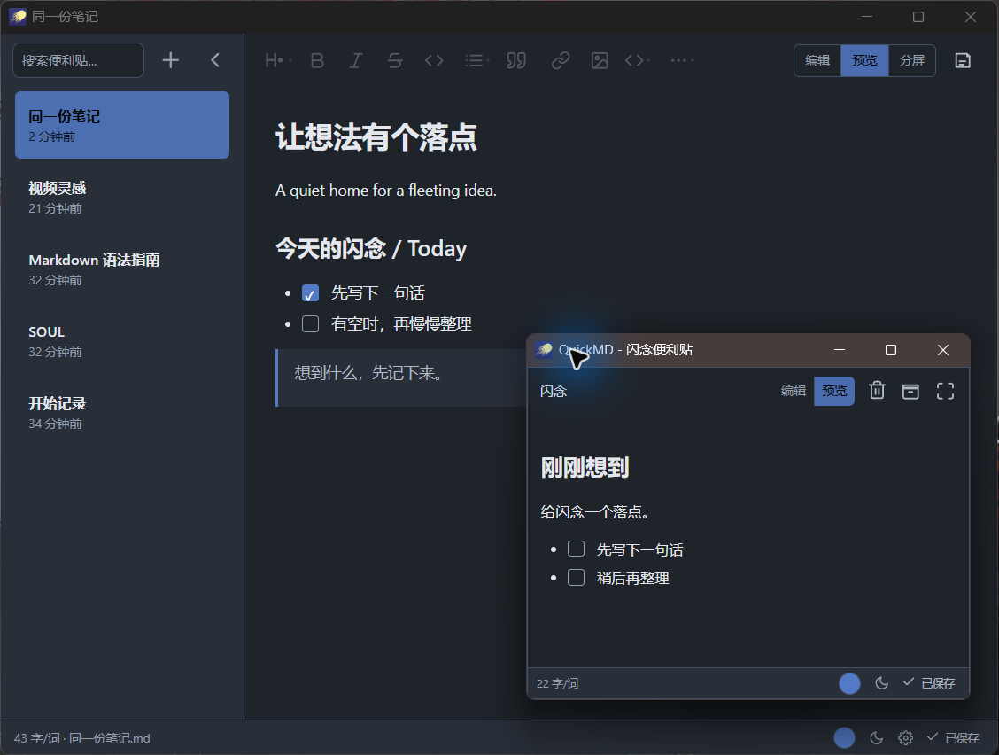
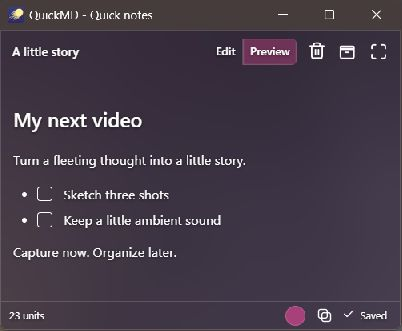
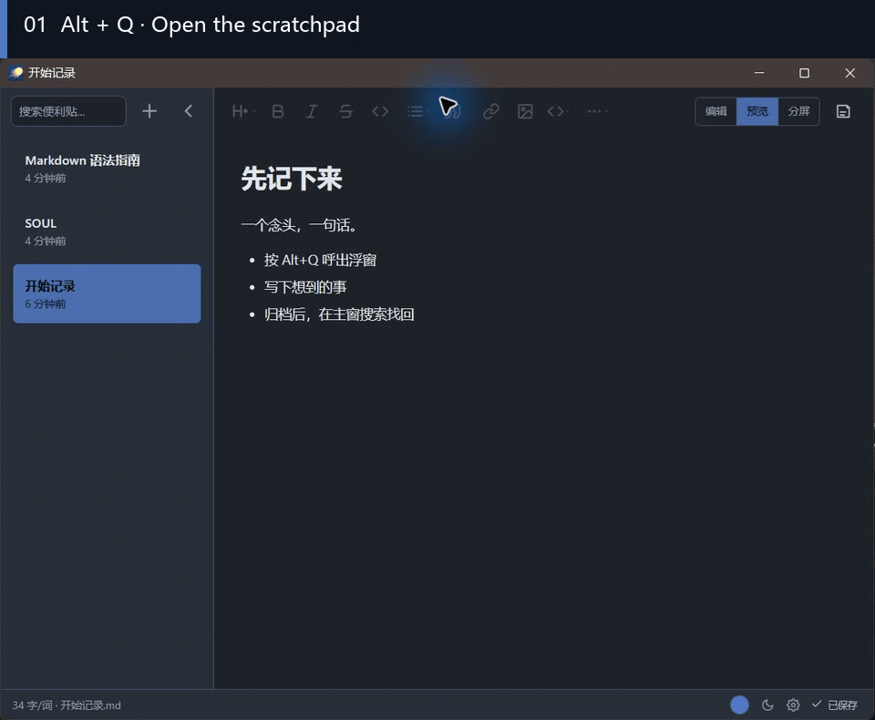
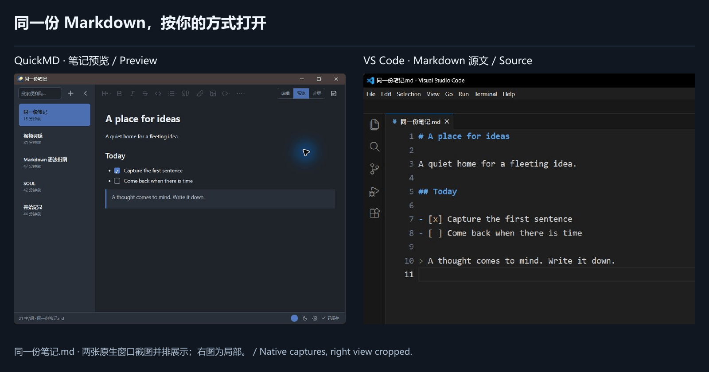

  

# QuickMD

**A thought comes to mind. Press Alt+Q. Write it down.**

A quiet, local Markdown scratchpad for Windows. 
Capture ideas in a floating window, find them in your library, and keep them as ordinary files.

[Download & install](#download) · [Watch the workflow](#workflow) · [Get started](#quick-start) · [简体中文](README.zh-CN.md) · [MIT](LICENSE)

*Native Windows capture · QuickMD 0.7.4 · Dedicated demo notes. Shown with a rose accent and 42% glass opacity; appearance varies with the wallpaper, Windows and runtime environment.*

<strong>See the library and scratchpad together (Chinese UI)</strong>

A single native desktop capture in the dark theme. The library keeps earlier notes while the scratchpad holds a new thought.

## Capture now. Make sense of it later.

A connection you notice while reading. A title for your next piece. An idea you cannot test while coding. Start with a sentence and come back to it when you have time.

### Catch a thought while it is still there

While QuickMD is running, press **Alt+Q** to open the scratchpad and start typing. You can name and organize the note later. Capture the thought, then return to what you were doing.

  

*The native scratchpad: capture a sentence now, organize it later.*

### Come back when you are ready

Click **Archive** to move the scratchpad content into your library. Search note contents, add tags, pin notes, rename them or export them as your ideas develop.

To revisit an archived note in the scratchpad, choose **Copy to scratchpad**. This creates an editable copy and keeps the original archive entry.

**Capture, archive and find an idea again — in about 26 seconds**

*Native Windows recording with Chinese UI and English step captions. Idle intervals have been cut; the actions shown run at normal speed.*

### Ordinary files, on your own computer

Archived note text is stored in `.md` files you can open in another Markdown editor. No accounts, telemetry or cloud sync. Everyday writing works offline. Image copies and the tag index live alongside your notes; include them in your backups.

*The same file, two ways to view it. Native window captures are arranged side by side; the VS Code view is cropped. Tags remain in a separate index.*

## Your first note

1. **Install and launch QuickMD**, and keep it running.
2. Press **Alt+Q** and write a sentence. Click the scratchpad title if you want to name it.
3. Click **Archive**. If the name is already taken, QuickMD numbers the new file and keeps the existing one.
4. Open the library and search for a word you just wrote.

Autosave is on by default. The status bar shows saving progress or errors. You can turn autosave off in Settings and save with **Ctrl+S** instead. The global shortcut is also configurable.

## Room for an idea to grow

| When you want to… | Use… |
| --- | --- |
| Write first, check the layout later | Edit, preview and split modes |
| Keep lists and references | Task lists, tables, footnotes and local images; drop multiple images to insert them |
| Save code or explain a process | Syntax highlighting and Mermaid diagrams |
| Find connections in older notes | Full-text search, tags, pins, find and replace |
| Make the space comfortable | Light, dark and frosted-glass themes, with an adjustable accent color |
| Work in a familiar language | English, Simplified Chinese or System default |

New profiles start with mist blue and frosted glass. Click the theme icon in the status bar to cycle through dark, light and glass. Settings save as you change them. Switching the interface language never translates, renames or overwrites your notes.

## Download & install

**[Visit GitHub Releases](https://github.com/druidjay325-tech/QuickMD/releases)** for published versions, release notes and installers.

> Current source version: **0.7.4**. As of October 10, 2026, the local release record still identifies unsigned candidate builds. Available public downloads are the actual assets on Releases. If no installer is listed yet, wait for publication or [build from source](docs/development.md).

| Requirement | Details |
| --- | --- |
| Supported system | Windows 10 / 11, x64. No macOS, Linux or mobile build is currently offered. |
| Installer choice | Usually `QuickMD_<version>_x64-setup.exe`; choose `.msi` if you need MSI. Install one, not both. |
| Base runtime | Microsoft Edge WebView2 Runtime. If missing, the installer may need an internet connection to download it. |
| Frosted glass | Also requires Windows App Runtime 2.5.1 x64, or a newer runtime in the 2.5 series. The installer does not install this runtime. |
| Glass unavailable | A readable solid background is used and Settings explains why. Windows transparency settings can also affect the result. |

Check the release notes, signature status and SHA-256 for the version you download. Unsigned candidates may trigger Windows security prompts; verify their source and checksum first.

## A few things worth knowing

<strong>Do I need to know Markdown?</strong>

You can write plain text right away. The toolbar provides headings, lists, links and other formatting tools; preview and split modes show the result. On first launch, QuickMD creates editable welcome and Markdown guide notes in the selected language.

<strong>Where are my files, and what should I back up?</strong>

The default archive is `%USERPROFILE%/QuickMD/flashthoughts/`: note text in `.md` files, a separate `tags.json` index, and image copies in `.assets/`. Drafts and previous versions live under `%USERPROFILE%/QuickMD/`. Settings normally live in `%APPDATA%/QuickMD/settings.json`.

Changing the archive location copies and checks the data before switching, and keeps the original directory. Back up the archive, drafts, previous versions and configuration together. See [data protection and recovery (Chinese)](docs/data-safety.md) for the full paths and recovery procedure.

<strong>Does it connect to the internet? Is there sync?</strong>

Everyday writing and local previews work offline, with no accounts, telemetry or built-in cloud sync. Manually choosing **Check for updates** requests GitHub release information without uploading note content. External links require confirmation. Previews do not automatically load remote images or execute raw HTML.

This version focuses on quick capture and a local archive. Cloud sync, subfolders and large knowledge-base features are outside its current scope.

<strong>Can I recover a deleted note?</strong>

Deleted notes go to the Windows Recycle Bin and can be restored there. This restores the Markdown file; separate tags and pins need to be added again. Previous-version recovery is not a substitute for a full backup. See [data protection and recovery (Chinese)](docs/data-safety.md).

<strong>What if Alt+Q does nothing?</strong>

Make sure QuickMD is running, then check the global shortcut in Settings. Choose another combination if a different app uses it. If the problem persists, report your Windows version, QuickMD version and reproduction steps. You do not need to share private notes.

## Help shape QuickMD

QuickMD is built around capturing a thought before organizing it: the scratchpad is for now, the library is for later. It is maintained by **DruidJay** and built with Tauri, Rust, React and TypeScript.

[Report an issue or share your experience](https://github.com/druidjay325-tech/QuickMD/issues). A concrete situation helps most: **When did you open it? Which step interrupted your train of thought?**

To contribute, start with the [development guide](docs/development.md) and [contribution guidelines](CONTRIBUTING.md). See the [changelog (Chinese)](CHANGELOG.md) for version changes. Follow the [security policy](SECURITY.md) for security reports.

If QuickMD helps you capture a few good ideas, share it with someone who could use it, or leave a Star. Author contact details are under **Settings → About QuickMD**. The optional support entry is currently available only in the Simplified Chinese interface.

Source code is licensed under [MIT](LICENSE). Third-party components and assets retain their own licenses; see [third-party notices](THIRD_PARTY_NOTICES.md).
