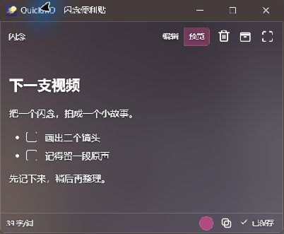
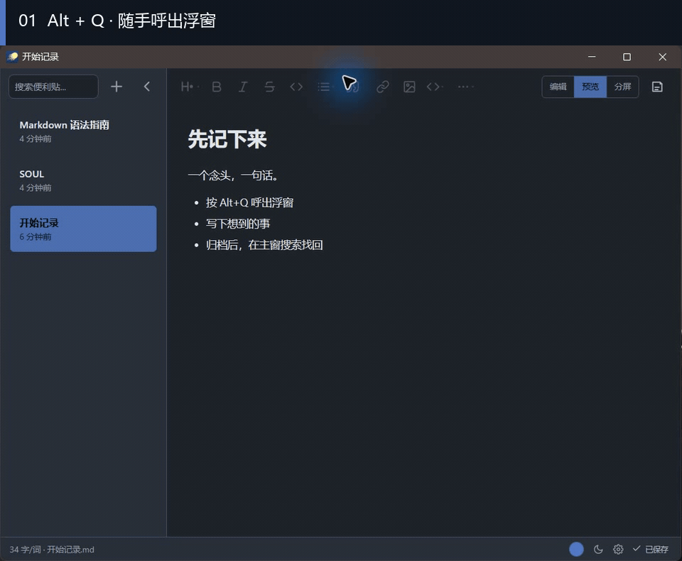
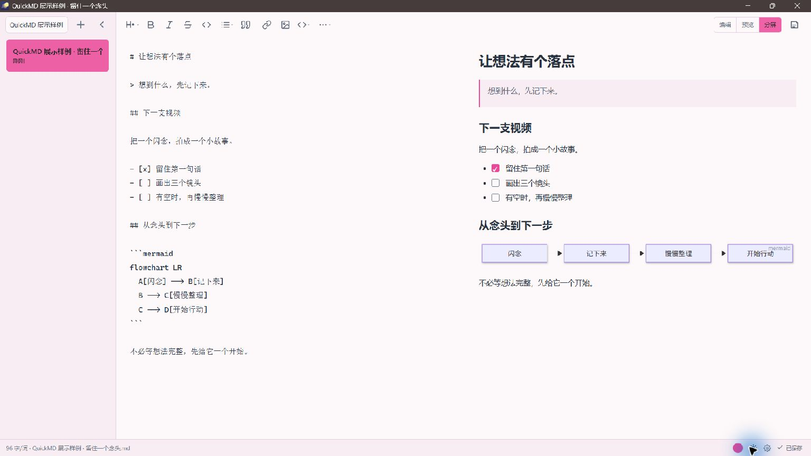
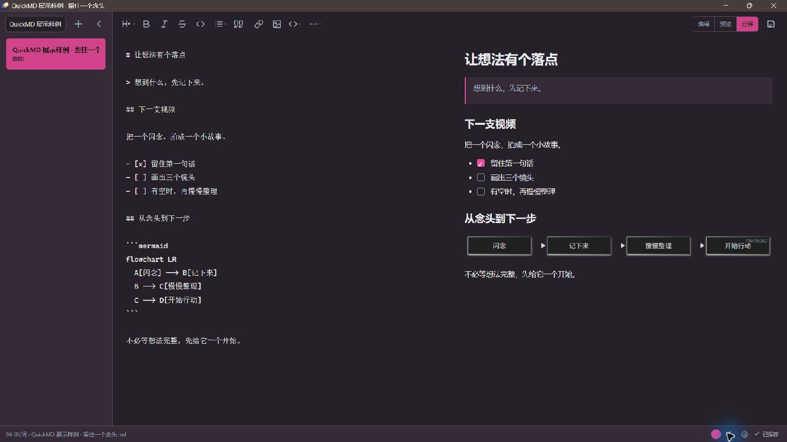

  

# QuickMD · 闪念便利贴

**想到什么，Alt+Q 一下，先记下来。**

一个安静的 Windows 本地 Markdown 便利贴。 
用浮窗抓住念头，在主窗搜索整理，内容保存为普通文件。

[下载与安装](#download) · [看完整流程](#workflow) · [快速上手](#quick-start) · [English](README.md) · [MIT](LICENSE)

*Windows 桌面实拍 · QuickMD 0.7.4 · 独立演示内容。主窗整理已有笔记，浮窗留住当下的念头；图中为深色主题。*

## 先留住，再慢慢整理

阅读时冒出的一句联想、写作中想到的下一个选题、开发时暂时没空验证的思路——都可以先从一句话开始。

### 念头来了，随手记

QuickMD 运行时，按 **Alt+Q** 呼出浮窗，直接开始写。暂时不用取一个完美的标题，也不用先决定分类。记录之后，回到手头的事。

  

*原生浮窗实拍：先把一句话留下，稍后再整理。*

### 有空的时候，再把它找回来

点击浮窗里的 **归档**，把内容移入档案。主窗可以搜索正文、打标签、置顶、重命名和导出，让零散的念头慢慢长成可用的内容。

需要继续琢磨时，可以把档案里的便利贴 **移入浮窗**：它会创建可编辑副本，保留原来的档案。

**从闪念到找回：约 26 秒完整演示**

*Windows 桌面实录。等待片段已剪去，操作保持原速。*

### 普通文件，留在自己手里

档案中的正文就是 `.md` 文件，可以用其他 Markdown 编辑器打开。没有账号、遥测或云同步；日常记录无需联网。图片副本和标签索引保存在档案旁边，备份时一起带走。

*同一文件，两种查看方式。两张原生窗口截图并排展示，右图为局部；标签仍保存在独立索引中。*

## 第一条便利贴，从这里开始

1. **安装并启动 QuickMD**，让它保持运行。
2. 按 **Alt+Q**，写下一句话；想命名时，点击浮窗标题。
3. 点击 **归档**，把内容保存到档案；已有同名文件会保留，新文件自动编号。
4. 打开主窗，搜索刚才写下的词，找到这条便利贴。

默认开启自动保存；底部状态会显示保存进度或错误。也可以在设置中关闭自动保存，使用 **Ctrl+S** 手动保存。全局快捷键可在设置中更改。

## 一句话，也可以慢慢展开

| 你想做的事 | QuickMD 提供的工具 |
| --- | --- |
| 先写文字，再看排版 | 编辑、预览和分屏模式 |
| 留下清单与资料 | 任务列表、表格、脚注、本地图片；支持拖入多张图片 |
| 记一段代码或画清思路 | 代码高亮、Mermaid 图表 |
| 从旧想法中找线索 | 正文搜索、标签、置顶、查找替换 |
| 调成舒服的样子 | 深色、浅色、毛玻璃主题，自定义强调色 |
| 用熟悉的语言操作 | 简体中文、English、跟随系统 |

新用户默认使用雾蓝与毛玻璃主题。点击底部主题图标，可依次切换深色、浅色与毛玻璃；设置调整即时保存。界面语言切换不会翻译、改名或覆盖你的便利贴。

<strong>看看同一条便利贴的浅色与深色主题</strong>

| 浅色 | 深色 |
| --- | --- |
|  |  |

同一份演示内容在浅色与深色主题下的实拍。点击图片可查看完整截图。

## 下载与安装

**[前往 GitHub Releases](https://github.com/druidjay325-tech/QuickMD/releases)**，查看公开版本、更新说明和安装包。

> 当前代码版本：**0.7.4**。截至 2026-10-10，本地发行记录仍为未签名候选包；公开可下载版本以 Releases 实际附件为准。若尚无安装包，可等待发布或按[开发指南](docs/development.md)从源码构建。

| 项目 | 说明 |
| --- | --- |
| 支持系统 | Windows 10 / 11，x64；当前不提供 macOS、Linux 或手机版 |
| 安装包选择 | 一般使用 `QuickMD_<版本>_x64-setup.exe`；需要 MSI 时选择 `.msi`，二者选一 |
| 基础运行环境 | Microsoft Edge WebView2 Runtime；缺少时，安装程序可能需要联网下载 |
| 毛玻璃效果 | 另需 Windows App Runtime 2.5.1 x64，或更新的 2.5 系列运行库；安装包不会代装 |
| 缺少毛玻璃运行环境 | 使用可读的实色背景，设置中显示原因；系统透明效果设置也可能影响显示 |

下载后核对对应版本的说明、签名状态与 SHA-256。未签名候选包可能出现 Windows 安全提示，请先核实来源和校验信息。

## 使用前，你可能还想知道

<strong>不会 Markdown，也能使用吗？</strong>

可以直接输入普通文字。需要格式时，工具栏提供标题、列表、链接等操作；预览与分屏可以看到排版效果。首次启动会按界面语言提供可编辑的欢迎文档和 Markdown 指南。

<strong>文件存在哪里，怎样备份？</strong>

默认档案在 `%USERPROFILE%/QuickMD/flashthoughts/`：正文为 `.md`，标签索引为 `tags.json`，插入的图片副本在 `.assets/`。草稿和上一版在 `%USERPROFILE%/QuickMD/`，设置通常在 `%APPDATA%/QuickMD/settings.json`。

更换存档目录时，应用复制数据，核对后切换，原目录保留。备份时请同时保留档案、草稿、上一版和配置；[数据保护与恢复](docs/data-safety.md)列出了完整路径与恢复方法。

<strong>会联网吗？支持同步吗？</strong>

日常记录与本地预览无需联网，没有账号、遥测或内置云同步。只有主动点击“检查更新”时，应用才请求 GitHub 发布信息，不上传便利贴内容；打开外部链接前会确认。预览不自动加载网络图片，也不执行原始 HTML。

当前版本专注于闪念记录与本地档案，尚不提供云同步、子文件夹和大型知识库功能。

<strong>删除后能找回吗？</strong>

删除的便利贴进入 Windows 系统回收站，可从那里还原。还原的是 Markdown 正文，独立标签和置顶信息需要重新添加。上一版恢复与完整备份是不同的保护方式，详见[数据保护与恢复](docs/data-safety.md)。

<strong>Alt+Q 没反应怎么办？</strong>

先确认 QuickMD 已启动并保持运行，再检查设置中的全局快捷键。若与其他程序冲突，可更换组合键。仍无法呼出时，反馈 Windows 版本、QuickMD 版本和复现步骤即可，无需提供私人便利贴。

## 一起把它打磨好

QuickMD 围绕“先记下来”设计：浮窗负责当下，主窗负责之后。它由 **DruidJay** 维护，使用 Tauri、Rust、React 和 TypeScript 构建。

欢迎[反馈问题或使用感受](https://github.com/druidjay325-tech/QuickMD/issues)。比起一句“很好用”，一个具体场景更有帮助：**你在什么时候打开它？哪一步打断了思路？**

想参与开发，可以从[开发指南](docs/development.md)和[贡献说明](CONTRIBUTING.md)开始；版本变化见[更新记录](CHANGELOG.md)。安全问题请按[安全策略](SECURITY.md)反馈。

如果它帮你留住了几个好点子，欢迎把项目分享给需要的人，或用 Star 表示支持。作者联系方式与自愿支持入口位于 **设置 → 关于本项目**；支持入口目前仅在简体中文界面显示。

源码采用 [MIT License](LICENSE)。第三方组件与素材遵循各自许可，详见[第三方声明](THIRD_PARTY_NOTICES.md)。
